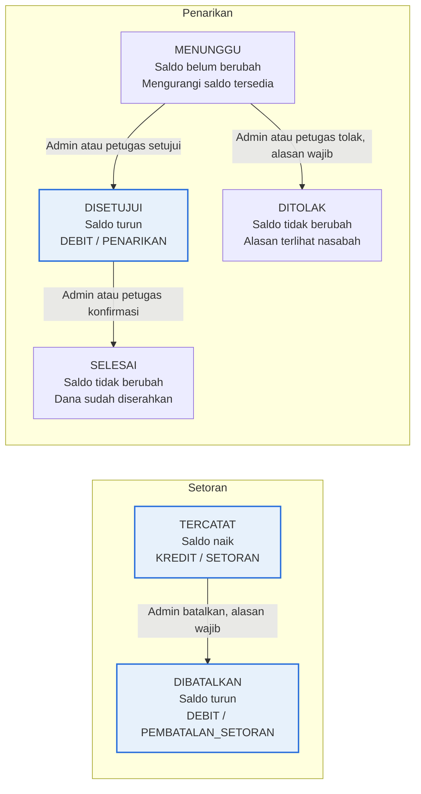

# PRD BinBank — Bank Sampah Digital RW

11 November 2026 · diperbarui 12 November 2026 · Violin

## 1. Problem statement

Nasabah, petugas, dan pengelola bank sampah RW dirugikan oleh pencatatan manual di buku tabungan: saldo rawan salah hitung, dan bila buku hilang atau rusak, saldo tidak dapat ditelusuri kembali.

| Pihak | Kerugian | Akar masalah |
| --- | --- | --- |
| Nasabah | Saldo bisa keliru tanpa disadari. Bila buku hilang atau rusak, saldo yang berhak ditarik praktis tidak dapat dibuktikan. | Buku tabungan fisik adalah satu-satunya catatan. |
| Petugas | Menghitung jenis × berat × harga dengan tangan untuk banyak nasabah sekaligus; salah hitung paling mungkin terjadi saat ramai. | Penjumlahan manual tanpa validasi. |
| Admin / pengelola | Setoran dan penarikan tidak tercatat terpusat. Harga per kg berbeda tiap jenis dan berubah sewaktu-waktu, sehingga rekap hanya bisa disusun dari buku manual. | Tidak ada catatan transaksi terpusat. |

Kerugian pengelola disimpulkan dari proses manual yang dideskripsikan. Belum ada data kuantitatif (frekuensi salah hitung, jumlah buku hilang); lihat OQ-20.

## 2. Target user dan persona

BinBank melayani satu RW dengan tiga peran. Mayoritas nasabah punya smartphone; semua peran memakai web responsif dan hanya saat ada koneksi.

| Peran | Siapa | Tugas utama di BinBank |
| --- | --- | --- |
| Nasabah | Warga RW yang menyetor sampah; didaftarkan admin atau petugas | Mengganti password awal, cek saldo dan riwayat, ajukan penarikan, pantau status pengajuan |
| Petugas | Pengurus yang melayani di lokasi penimbangan | Mendaftarkan nasabah, memasukkan hasil timbangan, melihat saldo nasabah, menyetujui atau menolak penarikan, menyerahkan dana |
| Admin | Pengelola bank sampah; boleh lebih dari satu | Kelola akun dan reset password, jenis sampah dan harga; setujui penarikan; lihat laporan |

Dua persona di bawah ini ilustratif, disusun dari deskripsi kebutuhan, dan belum divalidasi lewat wawancara lapangan.

### Persona 1 — Dani, petugas penimbangan

- **Konteks:** melayani banyak nasabah dalam satu waktu di lokasi bank sampah; menimbang tiap jenis sampah lalu mencatatnya.
- **Tujuan:** memasukkan hasil timbangan dengan cepat tanpa menghitung nilai sendiri.
- **Frustrasi saat ini:** menghitung berat × harga tiap jenis dengan tangan; salah hitung saat ramai.
- **Kebutuhan:** memilih nasabah, mengisi beberapa jenis sampah dan beratnya dalam satu setoran, melihat nilai terhitung otomatis, dan memeriksa saldo nasabah di tempat.

### Persona 2 — Bu Sari, nasabah

- **Konteks:** warga RW dengan smartphone; menyetor sampah dan menarik saldo sewaktu-waktu.
- **Tujuan:** mengetahui saldo tanpa bertanya ke petugas atau bergantung pada buku; menarik saldo tunai atau ke e-wallet.
- **Frustrasi saat ini:** buku bisa hilang atau rusak; hitungan di buku tidak bisa ia periksa sendiri.
- **Kebutuhan:** login dengan password buatannya sendiri, melihat saldo, riwayat setoran dan penarikan, serta status pengajuan.

## 3. Goals dan non-goals

### Goals

- **G1.** Nilai setoran dihitung otomatis di server; tidak ada perhitungan manual oleh petugas.
- **G2.** Saldo nasabah selalu sama dengan buku besar digital, dan setiap perubahannya dapat ditelusuri.
- **G3.** Nasabah memeriksa saldo, riwayat, dan mengajukan penarikan sendiri lewat web responsif.
- **G4.** Tiga peran dengan otorisasi tegas; nasabah hanya dapat mengakses data miliknya sendiri.
- **G5.** Admin mengatur harga dan melihat rekap; perubahan harga tidak mengubah setoran yang sudah tercatat.
- **G6.** MVP lulus demo end-to-end dan uji coba dengan data nyata di satu RW.

### Non-goals

- Lebih dari satu RW (multi-RW atau multi-tenant).
- Aplikasi mobile native, mode offline, atau sinkronisasi data; aplikasi dipakai saat ada koneksi.
- Integrasi payment gateway atau e-wallet; di MVP penarikan e-wallet ditransfer manual, datanya tetap tersimpan.
- Peta titik dan jadwal penjemputan.
- Impor saldo atau riwayat dari buku tabungan lama.
- Batas minimum penarikan dan batas frekuensi penarikan (tidak ada aturan).
- Pendaftaran mandiri oleh calon nasabah.
- Pengiriman email oleh sistem (verifikasi, reset password, notifikasi); email hanya menjadi identitas login.
- Pembatalan pengajuan penarikan oleh nasabah, serta koreksi pengajuan yang sudah DISETUJUI.
- Riwayat perubahan harga; harga lama tetap terlihat pada setoran lama.
- Menyimpan data kependudukan (KK, NIK, alamat) dan nomor HP; data pribadi dibatasi pada nama dan email (lihat F2 dan OQ-22).

### Batasan produk dan teknis

| Aspek | Ketentuan |
| --- | --- |
| Platform | Web responsif (lebar ponsel sampai desktop); wajib ada koneksi internet |
| Stack saat ini (README repo) | Node.js + Express, MongoDB Atlas + Mongoose, JWT, bcrypt, Postman; REST API |
| Kondisi repo | Hanya backend; tidak ada folder frontend. UI web responsif belum ada |
| Tim | 4 anggota (README repo) |
| Repo | [GhaisaniCan/bin-bank](https://github.com/GhaisaniCan/bin-bank) |
| Hosting, anggaran, tenggat | Belum ditetapkan; lihat OQ-19 |

## 4. User stories

Semua story berada di MVP (F1–F14, lihat bagian 5).

| ID | Fitur | Story |
| --- | --- | --- |
| US-01 | F1 | Sebagai petugas, saya ingin masuk dengan akun saya sendiri supaya setiap setoran tercatat atas nama saya. |
| US-02 | F1 | Sebagai nasabah, saya ingin hanya dapat melihat data saya sendiri supaya saldo dan riwayat saya tidak terbuka bagi nasabah lain. |
| US-03 | F1 | Sebagai admin, saya ingin setiap peran hanya dapat mengakses fungsi yang menjadi wewenangnya supaya harga dan laporan tidak bisa diubah atau dilihat oleh peran lain. |
| US-04 | F2 | Sebagai admin, saya ingin membuat akun petugas dan admin serta mendaftarkan nasabah supaya hanya warga RW yang terdaftar yang dapat memakai BinBank. |
| US-05 | F2 | Sebagai nasabah, saya ingin mengganti password awal saya dengan password sendiri supaya hanya saya yang dapat masuk ke akun saya. |
| US-06 | F3 | Sebagai admin, saya ingin menambah dan mengubah jenis sampah beserta harga per kg supaya harga selalu mengikuti harga terbaru. |
| US-07 | F3 | Sebagai petugas atau nasabah, saya ingin melihat daftar harga yang berlaku supaya saya tahu nilai tiap jenis sampah. |
| US-08 | F4 | Sebagai petugas, saya ingin mencatat satu setoran berisi beberapa jenis sampah beserta beratnya supaya nilai terhitung otomatis dan tidak salah hitung. |
| US-09 | F5 | Sebagai nasabah, saya ingin saldo bertambah otomatis setiap setoran dicatat supaya saldo saya selalu terkini tanpa bergantung pada buku. |
| US-10 | F5 | Sebagai admin, saya ingin setiap perubahan saldo tersimpan sebagai catatan buku besar yang tidak dapat diubah supaya saldo dapat ditelusuri kembali. |
| US-11 | F6 | Sebagai nasabah, saya ingin melihat saldo terkini serta riwayat setoran dan penarikan saya supaya saya dapat memeriksa saldo kapan saja. |
| US-12 | F6 | Sebagai petugas atau admin, saya ingin melihat saldo dan riwayat nasabah tertentu supaya dapat melayani nasabah di lokasi. |
| US-13 | F7 | Sebagai nasabah, saya ingin mengajukan penarikan secara tunai atau ke e-wallet supaya saldo saya dapat dicairkan. |
| US-14 | F7 | Sebagai nasabah, saya ingin memantau status pengajuan saya supaya tahu apakah sudah disetujui, ditolak, atau selesai. |
| US-15 | F8 | Sebagai admin atau petugas, saya ingin menyetujui atau menolak pengajuan dengan alasan supaya penarikan terkendali dan nasabah tahu sebabnya. |
| US-16 | F9 | Sebagai admin, saya ingin melihat rekap setoran per periode (kg dan rupiah per jenis sampah) supaya saya dapat memantau bank sampah. |
| US-17 | F10 | Sebagai admin, saya ingin membatalkan setoran yang salah input beserta alasannya supaya saldo benar dan riwayat koreksi tetap tercatat. |
| US-18 | F11 | Sebagai admin, saya ingin menonaktifkan dan mengaktifkan kembali jenis sampah, akun petugas, dan akun nasabah supaya data transaksi lama tetap utuh. |
| US-19 | F12 | Sebagai admin, saya ingin melihat rekap penarikan per periode dan status serta total saldo seluruh nasabah supaya saya tahu kewajiban bank sampah kepada nasabah. |
| US-20 | F13 | Sebagai petugas atau admin, saya ingin memfilter daftar setoran menurut rentang tanggal dan nasabah supaya mudah menemukan setoran tertentu. |
| US-21 | F14 | Sebagai petugas atau admin, saya ingin menandai pengajuan yang disetujui sebagai SELESAI setelah dana diserahkan supaya jelas mana yang sudah dicairkan. |
| US-22 | F2 | Sebagai petugas, saya ingin mendaftarkan nasabah baru supaya warga yang baru bergabung dapat langsung menyetor. |
| US-23 | F2 | Sebagai admin, saya ingin mereset password pengguna yang lupa supaya mereka dapat masuk kembali. |

## 5. Daftar fitur

MVP mencakup 14 fitur: 9 fitur inti dan 5 fitur pendukung dari analisis fitur. Kolom Backend memuat status implementasi pada kode repo per 12 November 2026; UI belum dibuat.

### MVP

| No | Fitur | Peran | Backend (12 Nov 2026) |
| --- | --- | --- | --- |
| F1 | Login dan Otorisasi Berbasis Peran | Petugas, Nasabah, Admin | Selesai, kecuali F1.7 sebagian: login, profil, middleware peran, JWT 8 jam, bcrypt, pesan gagal login seragam, email huruf kecil. Akun nonaktif ditolak saat login, tetapi token yang sudah terbit tetap berlaku sampai berakhir (OQ-25) |
| F2 | Manajemen Akun Pengguna | Admin (akun admin, petugas, nasabah); Petugas (akun nasabah) | Selesai: `POST` dan `GET /users` (pencarian `?cari=`), reset password admin, ganti password sendiri, wajib ganti password awal; `/auth/register` hanya untuk admin pertama |
| F3 | Manajemen Jenis Sampah dan Harga | Admin (kelola), semua peran (lihat) | Selesai: GET, POST, PUT `/jenis-sampah`, PATCH status aktif |
| F4 | Pencatatan Setoran Nasabah | Petugas; daftar: Petugas, Admin | Selesai: POST, GET `/setoran`, GET `/setoran/:id`; satu transaksi database; tanggal diisi server |
| F5 | Akumulasi Saldo Otomatis (Buku Besar) | Sistem | Selesai: `ledgerService` dalam transaksi database, debit ditolak bila saldo kurang. Skrip rekonsiliasi (M1, M2) belum dibuat |
| F6 | Cek Saldo dan Riwayat Transaksi | Nasabah, Petugas, Admin | Selesai: `/penarikan/saldo` (saldo, tertahan, tersedia), `/penarikan/riwayat` berpaginasi untuk nasabah; `/nasabah/:id/saldo` dan `/riwayat` untuk petugas dan admin; rincian setoran lewat `/setoran/:id` |
| F7 | Pengajuan Penarikan Saldo | Nasabah | Selesai: POST `/penarikan/ajukan` (e-wallet wajib nama dan nomor, saldo tersedia, atomik), GET `/penarikan/saya` |
| F8 | Persetujuan dan Pemrosesan Penarikan | Admin, Petugas | Selesai: GET `/penarikan` (bawaan status `diajukan`), PATCH `/penarikan/:id/proses` (alasan wajib saat menolak; setuju dan debit satu transaksi) |
| F9 | Laporan dan Rekap | Admin | Selesai: GET `/laporan` dengan rekap total dan per jenis sampah, filter periode divalidasi |
| F10 | Pembatalan Setoran | Admin | Selesai: PATCH `/setoran/:id/batal` dengan alasan; entri pembalik dalam satu transaksi |
| F11 | Penonaktifan Jenis Sampah dan Akun | Admin | Sebagian: jenis sampah dan akun dapat dinonaktifkan dan diaktifkan (PATCH status); token akun nonaktif belum ditolak langsung (OQ-25) |
| F12 | Rekap Penarikan dan Saldo Seluruh Nasabah | Admin | Selesai: `/laporan` memuat rekap penarikan per status dan total saldo nasabah. Rekonsiliasi F12.3 belum dibuat |
| F13 | Filter Riwayat Setoran | Petugas, Admin | Selesai: GET `/setoran` dengan filter nasabah, periode, status, dan paginasi |
| F14 | Konfirmasi Dana Diserahkan | Admin, Petugas | Selesai: PATCH `/penarikan/:id/selesai` dengan catatan opsional; alur dua langkah (setujui lalu selesai) |

### v2

| Fitur | Peran | Catatan |
| --- | --- | --- |
| Integrasi payment gateway / e-wallet | Nasabah | Pencairan otomatis sebagai alternatif transfer manual; backend jadi perantara, kunci API disimpan aman di server |

### Nanti

| Fitur | Peran | Catatan |
| --- | --- | --- |
| Peta titik dan jadwal penjemputan | Nasabah, Petugas | Memakai API peta |

Pembagian v2 dan nanti sudah dikonfirmasi.

## 6. Functional requirement fitur MVP

### Ketentuan umum

- **U1.** Semua request selain login memerlukan token valid. Server memeriksa peran dan status aktif akun pada setiap request.
- **U2.** Semua perhitungan nilai dan saldo dilakukan di server; nilai hasil hitung dari klien diabaikan.
- **U3.** Nilai uang disimpan sebagai bilangan bulat rupiah. Berat dicatat dalam kg dengan presisi 0,01 kg. Subtotal tiap baris rincian dibulatkan ke rupiah terdekat; total setoran adalah jumlah subtotal yang sudah dibulatkan.
- **U4.** Tanggal dan waktu ditampilkan dalam WIB (UTC+7); batas periode laporan dan filter mengikuti WIB.
- **U5.** Antarmuka berbahasa Indonesia, responsif dari lebar ponsel sampai desktop, dan tidak punya mode offline.

### F1. Login dan Otorisasi Berbasis Peran

Peran: Petugas, Nasabah, Admin.

- **F1.1** Pengguna login dengan email dan password. Email unik tanpa membedakan huruf besar dan kecil.
- **F1.2** Password disimpan sebagai hash bcrypt; tidak pernah dikembalikan oleh API atau ditampilkan.
- **F1.3** Login berhasil menghasilkan token JWT yang hanya berisi ID dan peran pengguna. Token berlaku 8 jam.
- **F1.4** Login gagal menampilkan pesan yang sama untuk email tidak ditemukan dan password salah.
- **F1.5** Wewenang tiap peran mengikuti matriks di bawah; fungsi di luar wewenang ditolak di server, dan menunya tidak ditampilkan di UI.
- **F1.6** Nasabah hanya dapat membaca data miliknya; permintaan atas data nasabah lain ditolak.
- **F1.7** Akun nonaktif tidak dapat login, dan token yang sudah terbit atas akun itu ditolak.
- **F1.8** Logout menghapus token dari klien. Setelah token berakhir, pengguna diarahkan login ulang.

| Fungsi | Petugas | Nasabah | Admin |
| --- | --- | --- | --- |
| Buat akun petugas dan admin | – | – | ✓ |
| Daftarkan nasabah | ✓ | – | ✓ |
| Cari nasabah | ✓ | – | ✓ |
| Ubah password sendiri | ✓ | ✓ | ✓ |
| Reset password pengguna lain | – | – | ✓ |
| Kelola jenis sampah dan harga | – | – | ✓ |
| Lihat daftar harga | ✓ | ✓ | ✓ |
| Catat setoran | ✓ | – | – |
| Lihat daftar dan detail setoran | ✓ | Hanya miliknya | ✓ |
| Batalkan setoran | – | – | ✓ |
| Lihat saldo dan riwayat | Nasabah mana pun | Hanya miliknya | Nasabah mana pun |
| Ajukan penarikan | – | ✓ | – |
| Lihat daftar pengajuan penarikan | ✓ | Hanya miliknya | ✓ |
| Setujui atau tolak penarikan | ✓ | – | ✓ |
| Tandai penarikan SELESAI | ✓ | – | ✓ |
| Laporan dan rekap | – | – | ✓ |
| Nonaktifkan dan aktifkan kembali jenis sampah, akun petugas, akun nasabah | – | – | ✓ |

### F2. Manajemen Akun Pengguna

Peran: Admin (akun admin, petugas, dan nasabah); Petugas (akun nasabah).

- **F2.1** Admin membuat akun petugas dengan nama, email, dan password awal.
- **F2.2** Admin dan petugas mendaftarkan nasabah dengan nama, email, dan password awal. Tidak ada pendaftaran mandiri.
- **F2.3** Peran ditentukan oleh jenis pendaftaran yang dipilih admin atau petugas, bukan oleh isian pendaftar. Petugas hanya dapat membuat akun nasabah.
- **F2.4** Data yang disimpan dibatasi pada nama, email, dan password (hash), ditambah atribut sistem (peran, status aktif, penanda wajib ganti password, saldo). KK, NIK, alamat, dan nomor HP tidak disimpan (nomor HP: OQ-22).
- **F2.5** Email harus berformat valid dan unik; duplikat ditolak. Satu akun mewakili satu individu. Nasabah yang tidak punya email: OQ-22.
- **F2.6** Password awal wajib diganti saat login pertama; sebelum diganti, pengguna hanya dapat mengakses fungsi ganti password. Setiap pengguna juga dapat mengganti password sendiri kapan saja dengan memasukkan password lama.
- **F2.7** Lupa password: admin mereset password pengguna lain dengan password sementara, dan pengguna wajib menggantinya saat login berikutnya. Sistem tidak mengirim email.
- **F2.8** Admin dan petugas mencari nasabah menurut nama atau email; hasil pencarian menampilkan nama dan email sehingga nama kembar dapat dibedakan.
- **F2.9** Boleh ada beberapa admin. Admin pertama dibuat lewat data awal (seed); admin berikutnya dibuat oleh admin.

### F3. Manajemen Jenis Sampah dan Harga

Peran: Admin (kelola), semua peran (lihat).

- **F3.1** Admin menambah jenis sampah (nama, harga per kg) dan mengubah nama atau harganya.
- **F3.2** Semua peran melihat daftar jenis sampah aktif beserta harga yang berlaku.
- **F3.3** Nama tidak boleh kosong dan tidak boleh sama dengan jenis lain; harga harus lebih dari 0.
- **F3.4** Perubahan harga hanya berlaku untuk setoran berikutnya; nilai setoran yang sudah tercatat tidak berubah.
- **F3.5** Jenis sampah tidak dapat dihapus; hanya dinonaktifkan (F11).
- **F3.6** Daftar awal jenis sampah dan harga berasal dari pengelola (OQ-17). Riwayat perubahan harga tidak diperlukan; harga lama terlihat pada salinan di setoran lama.

### F4. Pencatatan Setoran Nasabah

Peran: Petugas (catat); Petugas dan Admin (lihat).

- **F4.1** Petugas memilih nasabah (dari akun terdaftar, lewat pencarian nama atau email) dan mengisi minimal satu baris rincian berisi jenis sampah dan berat (kg, presisi 0,01). Satu setoran dapat memuat beberapa jenis.
- **F4.2** Tanggal setoran diisi otomatis oleh server saat disimpan (WIB); petugas tidak dapat mengisi atau mengubahnya.
- **F4.3** Server menghitung subtotal tiap baris (berat × harga per kg yang berlaku, dibulatkan ke rupiah terdekat), total berat, dan total nilai (jumlah subtotal).
- **F4.4** Nama jenis dan harga per kg yang berlaku disalin ke tiap baris rincian saat disimpan.
- **F4.5** Sebelum disimpan, UI menampilkan layar konfirmasi berisi nasabah, rincian, dan total nilai. Setoran baru disimpan setelah petugas mengonfirmasi.
- **F4.6** Jika harga atau status jenis sampah berubah antara form dimuat dan disimpan, setoran ditolak dan petugas diminta memuat ulang harga sebelum menyimpan lagi.
- **F4.7** Validasi: berat numerik dan lebih dari 0; jenis sampah ada dan aktif; nasabah terdaftar (akun nasabah nonaktif: OQ-24); minimal satu baris. Satu kegagalan menolak seluruh setoran; tidak ada penyimpanan parsial.
- **F4.8** Setoran, entri buku besar, dan pembaruan saldo disimpan dalam satu transaksi database (F5).
- **F4.9** Setelah disimpan, UI menampilkan ringkasan: rincian, total nilai, dan saldo baru nasabah.
- **F4.10** Status awal setoran TERCATAT. Petugas tidak dapat mengubah atau menghapus setoran; koreksi hanya lewat F10.
- **F4.11** Petugas dan Admin melihat daftar setoran (tanggal, nasabah, total berat, total nilai, status) dan detail rinciannya; pemfilteran di F13.

### F5. Akumulasi Saldo Otomatis (Buku Besar)

Peran: Sistem.

- **F5.1** Setiap setoran TERCATAT membuat satu entri buku besar bertipe KREDIT sebesar total nilai, sumber SETORAN, dengan referensi ke setoran.
- **F5.2** Setiap entri menyimpan saldo nasabah setelah transaksi (saldoSetelah).
- **F5.3** Penyimpanan setoran, entri buku besar, dan pembaruan saldo bersifat atomik: bila salah satu gagal, semuanya dibatalkan.
- **F5.4** Entri buku besar tidak dapat diubah atau dihapus oleh peran mana pun, lewat UI maupun API.
- **F5.5** Saldo nasabah selalu sama dengan saldoSetelah pada entri terakhirnya, dan sama dengan jumlah KREDIT dikurangi jumlah DEBIT.
- **F5.6** Dua transaksi bersamaan pada nasabah yang sama tidak boleh menghasilkan saldoSetelah yang salah.
- **F5.7** Jenis entri: KREDIT/SETORAN, DEBIT/PENARIKAN (F8), DEBIT/`PEMBATALAN_SETORAN` (F10).

### F6. Cek Saldo dan Riwayat Transaksi

Peran: Nasabah (miliknya), Petugas dan Admin (nasabah mana pun).

- **F6.1** Nasabah melihat saldo terkini dan saldo tersedia (saldo dikurangi total pengajuan berstatus MENUNGGU).
- **F6.2** Nasabah melihat riwayat mutasi dari buku besar, terbaru dulu: tanggal, jenis mutasi, jumlah, dan saldoSetelah.
- **F6.3** Nasabah dapat membuka rincian setiap setoran miliknya (jenis, berat, harga, subtotal).
- **F6.4** Riwayat memuat entri pembalik hasil pembatalan setoran (F10), sehingga koreksi terlihat.
- **F6.5** Petugas dan Admin memilih nasabah, lalu melihat saldo dan riwayatnya.
- **F6.6** Riwayat dipaginasi.
- **F6.7** Pengajuan MENUNGGU atau DITOLAK tidak ada di buku besar karena saldo belum berubah; statusnya dilihat lewat daftar pengajuan (F7.4).

### F7. Pengajuan Penarikan Saldo

Peran: Nasabah.

- **F7.1** Nasabah mengisi nominal (rupiah) dan memilih metode: TUNAI atau E-WALLET. Untuk E-WALLET, nama dan nomor e-wallet wajib diisi sebagai isian bebas, tanpa validasi format.
- **F7.2** Validasi: nominal bilangan bulat lebih dari 0 dan tidak melebihi saldo tersedia (saldo dikurangi total pengajuan MENUNGGU). Tidak ada batas minimum maupun batas frekuensi.
- **F7.3** Pengajuan tersimpan berstatus MENUNGGU; saldo belum berkurang.
- **F7.4** Nasabah melihat daftar pengajuannya: tanggal, nominal, metode, status, dan alasan penolakan bila DITOLAK.
- **F7.5** Pengecekan saldo tersedia dan penyimpanan pengajuan bersifat atomik, sehingga dua pengajuan bersamaan tidak dapat melebihi saldo.
- **F7.6** Nama dan nomor e-wallet tersimpan pada pengajuan, sebagai catatan transfer manual.
- **F7.7** Nasabah tidak dapat membatalkan pengajuan MENUNGGU; pengajuan hanya berakhir lewat keputusan admin atau petugas.

### F8. Persetujuan dan Pemrosesan Penarikan

Peran: Admin, Petugas.

- **F8.1** Admin dan petugas melihat daftar pengajuan, dapat disaring menurut status (bawaan MENUNGGU): nasabah, nominal, metode, nama dan nomor e-wallet.
- **F8.2** Setujui: status menjadi DISETUJUI; saldo dikurangi sebesar nominal; satu entri DEBIT/PENARIKAN tercatat dengan saldoSetelah; semuanya satu transaksi atomik. Pemroses (admin atau petugas) dan waktu diproses tersimpan.
- **F8.3** Tolak: alasan wajib diisi; status menjadi DITOLAK; saldo tidak berubah; alasan terlihat oleh nasabah.
- **F8.4** Hanya pengajuan berstatus MENUNGGU yang dapat diproses; pemrosesan ulang ditolak.
- **F8.5** Saat persetujuan, sistem memeriksa ulang saldo nasabah. Jika saldo lebih kecil dari nominal, persetujuan ditolak dengan pesan jelas dan pengajuan tetap MENUNGGU.
- **F8.6** Pencairan setelah DISETUJUI dilakukan di luar sistem: tunai oleh petugas atau admin, atau transfer manual ke e-wallet (F14).
- **F8.7** Tidak ada jalur koreksi di MVP bila dana batal diserahkan setelah DISETUJUI; hal itu ditangani di luar sistem.

### F9. Laporan dan Rekap

Peran: Admin.

- **F9.1** Admin memilih periode (tanggal mulai dan akhir, inklusif); tanggal mulai tidak boleh setelah tanggal akhir.
- **F9.2** Rekap setoran menampilkan, per jenis sampah, total berat (kg) dan total nilai (rupiah), ditambah total keseluruhan.
- **F9.3** Hanya setoran TERCATAT yang dihitung; DIBATALKAN dikecualikan dari rekap.
- **F9.4** Rekap memakai harga yang tersalin pada setoran, bukan harga saat ini.
- **F9.5** Angka rekap dihitung dari data transaksi, tanpa input manual.
- **F9.6** Periode tanpa setoran menampilkan nol, bukan error.

### F10. Pembatalan Setoran

Peran: Admin.

- **F10.1** Admin memilih setoran TERCATAT dan membatalkannya dengan alasan wajib.
- **F10.2** Setoran tidak dihapus: status menjadi DIBATALKAN; alasan, pelaku, dan waktu pembatalan tersimpan.
- **F10.3** Sistem membuat entri pembalik DEBIT/`PEMBATALAN_SETORAN` sebesar total nilai setoran, dan saldo berkurang; atomik.
- **F10.4** Setoran DIBATALKAN tidak dapat dibatalkan lagi atau dipulihkan. Koreksi ulang dicatat sebagai setoran baru.
- **F10.5** Setoran DIBATALKAN tetap tampil di daftar dengan penanda status.
- **F10.6** Bila saldo nasabah lebih kecil dari nilai setoran (sebagian sudah ditarik), pembatalan ditolak sistem dengan pesan jelas; saldo tidak pernah negatif.

### F11. Penonaktifan Jenis Sampah dan Akun

Peran: Admin.

- **F11.1** Admin menonaktifkan jenis sampah: tidak muncul di form setoran baru, tetap tampil pada setoran lama, tidak dihapus.
- **F11.2** Admin menonaktifkan akun petugas atau nasabah: akun tidak dapat login, token yang ada ditolak (F1.7), dan data transaksi lamanya tetap tercatat.
- **F11.3** Admin dapat mengaktifkan kembali jenis sampah, akun petugas, dan akun nasabah yang dinonaktifkan.
- **F11.4** Entitas yang sudah punya transaksi tidak dapat dihapus.
- **F11.5** Penonaktifan akun admin: OQ-23. Perlakuan setoran, penarikan, dan saldo akun nasabah nonaktif: OQ-24.

### F12. Rekap Penarikan dan Saldo Seluruh Nasabah

Peran: Admin.

- **F12.1** Rekap penarikan per periode dan per status (MENUNGGU, DISETUJUI, DITOLAK, SELESAI): jumlah pengajuan dan total nominal. Periode dihitung dari tanggal pengajuan.
- **F12.2** Total saldo seluruh nasabah ditampilkan sebagai jumlah saldo semua akun nasabah saat ini.
- **F12.3** Total saldo sama dengan jumlah saldo terakhir pada buku besar seluruh nasabah (rekonsiliasi, lihat M1).

### F13. Filter Riwayat Setoran

Peran: Petugas, Admin.

- **F13.1** Daftar setoran dapat disaring menurut rentang tanggal, nasabah, atau keduanya; tanpa filter menampilkan semua.
- **F13.2** Rentang tanggal inklusif; tanggal mulai tidak boleh setelah tanggal akhir.
- **F13.3** Hasil diurutkan terbaru dulu dan dipaginasi.

### F14. Konfirmasi Dana Diserahkan

Peran: Admin, Petugas.

- **F14.1** Pengajuan DISETUJUI dapat ditandai SELESAI oleh Admin atau Petugas setelah dana diserahkan (tunai) atau ditransfer manual (e-wallet).
- **F14.2** Petugas melihat daftar pengajuan DISETUJUI (nasabah, nominal, metode, nama dan nomor e-wallet) untuk keperluan pencairan.
- **F14.3** Hanya transisi DISETUJUI ke SELESAI yang diizinkan; satu arah. Saldo dan buku besar tidak berubah, karena saldo sudah dikurangi saat disetujui.
- **F14.4** Pelaku dan waktu konfirmasi tersimpan, beserta catatan opsional (misalnya referensi transfer).
- **F14.5** Nasabah melihat status SELESAI pada daftar pengajuannya.

## 7. Sketsa data model

Lima entitas. Nilai uang berupa bilangan bulat rupiah; berat dalam kg.

| Entitas | Field kunci | Catatan |
| --- | --- | --- |
| Pengguna | id, nama, email, passwordHash, peran (petugas / nasabah / admin), aktif, wajibGantiPassword, saldo | Email unik dan menjadi identitas login; nomor HP tidak disimpan (OQ-22). `saldo` hanya bermakna untuk nasabah; salinan yang selalu sama dengan saldoSetelah terakhir di BukuBesar |
| JenisSampah | id, nama, hargaPerKg, aktif | Tidak pernah dihapus |
| Setoran | id, nasabahId, petugasId, tanggal, rincian[ ], totalBerat, totalNilai, status (TERCATAT / DIBATALKAN), alasanPembatalan, dibatalkanOleh, dibatalkanPada | Tanggal diisi server saat disimpan. Rincian tertanam: jenisSampahId, namaJenis, hargaPerKg, beratKg, subtotal. Nama dan harga adalah salinan saat setoran |
| Penarikan | id, nasabahId, jumlah, metode (TUNAI / E-WALLET), namaEwallet, nomorEwallet, status (MENUNGGU / DISETUJUI / DITOLAK / SELESAI), diajukanPada, diprosesOleh, diprosesPada, alasanPenolakan, dikonfirmasiOleh, dikonfirmasiPada, catatan | namaEwallet dan nomorEwallet wajib bila metode E-WALLET (isian bebas). diprosesOleh adalah admin atau petugas |
| BukuBesar | id, nasabahId, tipe (KREDIT / DEBIT), jumlah, saldoSetelah, sumber (SETORAN / PENARIKAN / `PEMBATALAN_SETORAN`), referensiId, keterangan, dibuatPada | Hanya ditambah, tidak pernah diubah atau dihapus |

**Relasi.** Satu nasabah memiliki banyak Setoran, Penarikan, dan entri BukuBesar. Satu petugas mencatat banyak Setoran. Satu Setoran menghasilkan satu entri KREDIT, dan satu entri DEBIT pembalik bila dibatalkan. Satu Penarikan DISETUJUI menghasilkan satu entri DEBIT.

**Invarian.**

- Saldo nasabah tidak pernah negatif; pembatalan setoran yang akan membuatnya negatif ditolak.
- Saldo nasabah sama dengan saldoSetelah entri BukuBesar terakhirnya.
- totalNilai setoran sama dengan jumlah subtotal; subtotal sama dengan berat × harga yang tersalin, dibulatkan ke rupiah terdekat per baris.
- BukuBesar bersifat append-only.
- Email pengguna unik.

### Siklus status

Hanya tiga status yang mengubah saldo (diberi warna biru); masing-masing menghasilkan satu entri buku besar.

### Selisih dengan repo saat ini

Berdasarkan kode backend per 12 November 2026. Butir awal yang sudah teratasi: `/auth/register` ditutup setelah admin pertama dan peran tidak dipilih pendaftar; penarikan memiliki nama dan nomor e-wallet, waktu proses, serta pelaku dan waktu konfirmasi; setoran menyimpan alasan, pelaku, dan waktu pembatalan; pengguna memiliki `aktif` dan `wajibGantiPassword`. Butir yang masih berbeda:

1. Status penarikan di kode huruf kecil (`diajukan`, `disetujui`, `ditolak`, `selesai`); PRD memakai MENUNGGU, DISETUJUI, DITOLAK, SELESAI. Keputusan: nilai di API tetap huruf kecil, dengan `diajukan` setara MENUNGGU.
2. Alasan penolakan disimpan di field `catatan` (bukan `alasanPenolakan` terpisah); catatan konfirmasi di `catatanKonfirmasi`. Field `catatan` pada setoran dipertahankan.
3. `jumlah`, `hargaPerKg`, dan `saldo` bertipe Number; penarikan divalidasi sebagai bilangan bulat dan subtotal setoran dibulatkan ke rupiah terdekat (U3), tetapi tipe tidak diganti.
4. Token akun yang dinonaktifkan tetap berlaku sampai berakhir (maksimal 8 jam), sedangkan F1.7 meminta token langsung ditolak. Usulan: periksa `aktif` di `authenticate` pada setiap request, dengan biaya satu query per request. Lihat OQ-25.
5. Skrip rekonsiliasi (M1, M2, F12.3) belum dibuat.
6. Tidak ada folder frontend; UI web responsif belum ada.

## 8. Edge case dan failure state

Kasus yang perilakunya belum diputuskan menunjuk ke bagian 10.

| Area | Kasus | Perilaku yang dituntut |
| --- | --- | --- |
| Setoran | Berat 0, negatif, kosong, atau bukan angka | Seluruh setoran ditolak dengan pesan per baris; tidak ada yang tersimpan |
| Setoran | Jenis sampah dinonaktifkan admin saat petugas mengisi form | Setoran ditolak; petugas diminta memuat ulang daftar jenis (F4.6) |
| Setoran | Harga diubah admin saat form terbuka | Setoran ditolak; petugas memuat ulang harga lalu menyimpan lagi (F4.6) |
| Setoran | Salah ketik berat yang tetap valid (mis. 250 bukan 2,5) | Layar konfirmasi (F4.5) memberi kesempatan memeriksa; bila tetap tersimpan, koreksi hanya lewat F10 |
| Setoran | Petugas menutup layar konfirmasi tanpa mengonfirmasi | Tidak ada yang tersimpan |
| Setoran | Nasabah tidak terdaftar, atau nama kembar | Setoran hanya untuk akun terdaftar; pencarian menampilkan nama dan email sehingga nama kembar dapat dibedakan (F2.8) |
| Setoran | Subtotal menghasilkan pecahan rupiah | Dibulatkan ke rupiah terdekat per baris (U3) |
| Integritas | Gagal di tengah transaksi (setoran tersimpan, buku besar gagal) | Semuanya dibatalkan; petugas menerima pesan gagal; tidak ada setoran parsial |
| Integritas | Tombol ditekan dua kali atau permintaan diulang setelah timeout | Tidak boleh terbentuk dua setoran atau dua pengajuan yang sama; tombol dinonaktifkan selama proses; sebelum mengulang, petugas memeriksa daftar setoran |
| Integritas | Dua pengajuan penarikan bersamaan melebihi saldo | Hanya yang masih muat dalam saldo tersedia diterima |
| Integritas | Dua pemroses (admin atau petugas) memproses pengajuan yang sama bersamaan | Hanya satu berhasil; yang lain menerima pesan status sudah berubah |
| Integritas | Setoran dibatalkan setelah sebagian saldo ditarik | Pembatalan ditolak sistem; saldo tidak pernah negatif (F10.6) |
| Integritas | Harga berubah setelah setoran tercatat | Nilai setoran lama tidak berubah |
| Penarikan | Nominal melebihi saldo tersedia (termasuk pengajuan MENUNGGU) | Ditolak dengan menampilkan saldo tersedia |
| Penarikan | Saldo nol | Pengajuan tidak dapat dibuat |
| Penarikan | E-WALLET tanpa nama atau nomor e-wallet | Ditolak |
| Penarikan | Penolakan tanpa alasan | Ditolak oleh sistem |
| Penarikan | Saldo nasabah turun di bawah nominal sebelum disetujui | Persetujuan ditolak sistem; pengajuan tetap MENUNGGU; pemroses menolak dengan alasan (F8.5) |
| Penarikan | DISETUJUI tetapi dana batal diserahkan | Status tetap DISETUJUI; saldo sudah berkurang; tidak ada jalur koreksi di MVP, ditangani di luar sistem (F8.7) |
| Penarikan | Transfer manual salah nomor e-wallet | Di luar kendali sistem; nama dan nomor pada pengajuan menjadi bukti |
| Akun | Pengguna dengan password sementara membuka fungsi selain ganti password | Ditolak sampai password diganti (F2.6) |
| Akun | Email yang didaftarkan sudah dipakai akun lain | Ditolak (F2.5) |
| Akun | Nasabah tanpa email | Lihat OQ-22 |
| Akun | Akun nasabah dinonaktifkan saat masih punya saldo atau pengajuan berjalan | Lihat OQ-24 |
| Akun | Lupa password | Admin mereset password; pengguna wajib menggantinya (F2.7) |
| Akses | Nasabah mengubah ID pada permintaan untuk membaca data nasabah lain | Ditolak |
| Akses | Peran mengakses fungsi di luar wewenangnya | Ditolak di server; menu tidak tampil di UI |
| Akses | Akun dinonaktifkan saat sesi berjalan | Permintaan berikutnya ditolak |
| Akses | Token kedaluwarsa saat form diisi | Token berlaku 8 jam; setelah berakhir pengguna diarahkan login ulang; isian yang belum tersimpan tidak dijamin |
| Akses | Pendaftaran publik lewat `/auth/register` | Harus ditutup (bagian 7, butir 1) |
| Sistem | Koneksi putus atau server error saat menyimpan | Pesan gagal yang jelas; tidak ada antrian offline; data dianggap belum tersimpan sampai server mengonfirmasi |
| Sistem | Database tidak tersedia | Pesan layanan tidak tersedia; tidak ada data parsial |
| Sistem | Riwayat atau daftar sangat panjang | Dipaginasi |
| Sistem | Periode laporan terbalik atau tanpa data | Terbalik: ditolak dengan pesan; tanpa data: tampil nol |

## 9. Success metrics

MVP dinyatakan selesai bila demo end-to-end semua fitur MVP lulus dan uji coba dengan data nyata di satu RW terlaksana dengan metrik di bawah terpenuhi.

### Kriteria selesai

1. **Demo end-to-end** tanpa intervensi manual di database, dengan urutan: admin membuat akun petugas serta mengisi jenis sampah dan harga; petugas mendaftarkan nasabah; nasabah login dan mengganti password awal; petugas mencatat setoran multi-jenis lewat layar konfirmasi; saldo dan riwayat nasabah ikut berubah; nasabah mengajukan penarikan tunai dan e-wallet; admin menyetujui satu dan petugas menolak satu dengan alasan; petugas menandai SELESAI; admin melihat rekap setoran, rekap penarikan, dan total saldo; admin membatalkan satu setoran dan buku besar mencatat entri pembalik; admin mengubah harga dan setoran lama tidak berubah; admin mereset password satu pengguna; admin menonaktifkan lalu mengaktifkan kembali satu jenis sampah, satu akun petugas, dan satu akun nasabah.
2. **Uji per fitur:** seluruh requirement F1–F14 lulus.
3. **Uji otorisasi negatif:** setiap sel kosong pada matriks wewenang (F1.5) ditolak, termasuk akses nasabah ke data nasabah lain.
4. **Uji coba data nyata di satu RW:** durasi, jumlah peserta, dan penilai ditetapkan di OQ-19; metrik M1–M10 diukur dan dilaporkan.

### Metrik

| ID | Metrik | Target | Cara ukur |
| --- | --- | --- | --- |
| M1 | Nasabah yang saldonya tidak sama dengan jumlah KREDIT dikurangi DEBIT di buku besar | 0 | Skrip rekonsiliasi pada akhir demo dan akhir uji coba |
| M2 | Setoran TERCATAT tanpa entri KREDIT, atau penarikan DISETUJUI tanpa entri DEBIT | 0 | Query rekonsiliasi |
| M3 | Nilai setoran dari sistem berbeda dari hitung ulang manual | 0 selisih pada seluruh sampel | Audit sampel selama uji coba; ukuran sampel: OQ-20 |
| M4 | Entri buku besar yang berubah atau terhapus | 0 | Uji API dan audit data |
| M5 | Uji otorisasi negatif yang lolos (seharusnya ditolak) | 0 | Uji per matriks wewenang |
| M6 | Setoran selama uji coba yang tercatat di BinBank | Target usulan: 100% | Bandingkan dengan catatan manual paralel |
| M7 | Nasabah terdaftar yang pernah login dan membuka saldo | Target usulan: 70% | Data login dan akses saldo |
| M8 | Waktu input satu setoran oleh petugas | Tidak lebih lama dari pencatatan manual | Baseline manual diukur di awal uji coba |
| M9 | Pengajuan penarikan yang diputuskan dalam batas waktu | Keputusan dalam 3 hari sejak pengajuan | Selisih waktu pengajuan dan pemrosesan |
| M10 | Kasus salah hitung atau saldo yang disengketakan karena sistem | 0 | Catatan keluhan petugas dan nasabah selama uji coba |

Target M6 dan M7 adalah usulan PRD, belum disepakati (OQ-20). Target M9 mengikuti keputusan 3 hari.

## 10. Open questions

Tujuh pertanyaan masih terbuka. Keputusan yang sudah diambil pada 11 November 2026 sudah diterapkan di bagian 1–9. Prioritas Tinggi berarti harus dijawab sebelum fitur terkait dibangun.

### Terbuka

| ID | Pertanyaan | Fitur | Prioritas |
| --- | --- | --- | --- |
| OQ-17 | Daftar awal jenis sampah dan harganya dari pengelola. | F3 | Sedang |
| OQ-19 | Uji coba data nyata: durasi (belum diputuskan), jumlah nasabah dan petugas, dan penilainya. Tenggat tugas akhir, hosting, dan anggaran. | G6, bagian 9 | Tinggi |
| OQ-20 | Data dasar proses manual (jumlah nasabah, setoran per minggu, frekuensi salah hitung, buku hilang), ukuran sampel audit M3, dan persetujuan target usulan M6 dan M7. | Bagian 1, 9 | Sedang |
| OQ-22 | Nasabah yang tidak punya email: email siapa yang dipakai (milik keluarga, atau dibuatkan admin)? Nomor HP tidak lagi disimpan; ini asumsi dari keputusan memakai email. Setuju? | F2 | Tinggi |
| OQ-23 | Bolehkah admin menonaktifkan akun admin lain atau akunnya sendiri? Kode saat ini menolak admin menonaktifkan akunnya sendiri. | F11 | Rendah |
| OQ-24 | Akun nasabah nonaktif yang masih punya saldo atau pengajuan berjalan: apakah pengajuan MENUNGGU dan DISETUJUI tetap diproses, dan apakah setoran baru ditolak? | F4, F7, F11 | Sedang |
| OQ-25 | Token akun nonaktif: apakah status `aktif` diperiksa pada setiap request (token langsung ditolak, satu query per request), atau cukup berhenti berlaku saat token berakhir (maksimal 8 jam)? | F1.7, F11.2 | Sedang |

### Sudah diputuskan

| ID | Keputusan | Berlaku di |
| --- | --- | --- |
| OQ-1 | Login dengan email | F1, F2, bagian 7 |
| OQ-2 | Admin dan petugas dapat mendaftarkan nasabah | F1.5, F2 |
| OQ-3 | Satu akun per individu; email unik (nomor HP tidak disimpan, lihat OQ-22) | F2 |
| OQ-4 | Password awal dibuat admin atau petugas dan wajib diganti saat login pertama; lupa password diselesaikan lewat reset oleh admin | F2 |
| OQ-5 | Pembatalan setoran diblokir bila saldo nasabah kurang dari nilai setoran | F10 |
| OQ-6 | Tidak ada jalur koreksi untuk pengajuan DISETUJUI di MVP | F8 |
| OQ-7 | Petugas dan admin dapat menyetujui atau menolak penarikan | F8 |
| OQ-8 | Nasabah tidak dapat membatalkan pengajuan | F7 |
| OQ-9 | Berat dengan presisi 0,01 kg; subtotal dibulatkan ke rupiah terdekat per baris rincian | U3, F4 |
| OQ-10 | Tanggal setoran otomatis saat disimpan | F4 |
| OQ-11 | Harga berubah saat form terbuka: setoran ditolak dan harga dimuat ulang | F4 |
| OQ-12 | Layar konfirmasi sebelum setoran disimpan | F4 |
| OQ-13 | E-wallet berupa isian bebas (nama dan nomor), tanpa validasi format | F7 |
| OQ-14 | Rekap penarikan memakai tanggal pengajuan | F12 |
| OQ-15 | Beberapa admin; admin pertama lewat seed. Jenis sampah, akun petugas, dan akun nasabah dapat dinonaktifkan dan diaktifkan kembali | F2, F11 |
| OQ-16 | Token login berlaku 8 jam | F1 |
| OQ-17 (sebagian) | Riwayat perubahan harga tidak diperlukan | F3 |
| OQ-18 | Payment gateway di v2, peta di nanti | Bagian 5 |
| OQ-20 (sebagian) | Pengajuan penarikan diputuskan dalam 3 hari | M9 |
| OQ-21 | Setoran DIBATALKAN dikecualikan dari rekap setoran | F9 |
